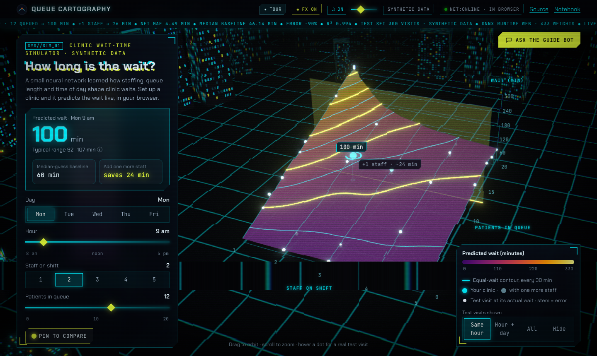
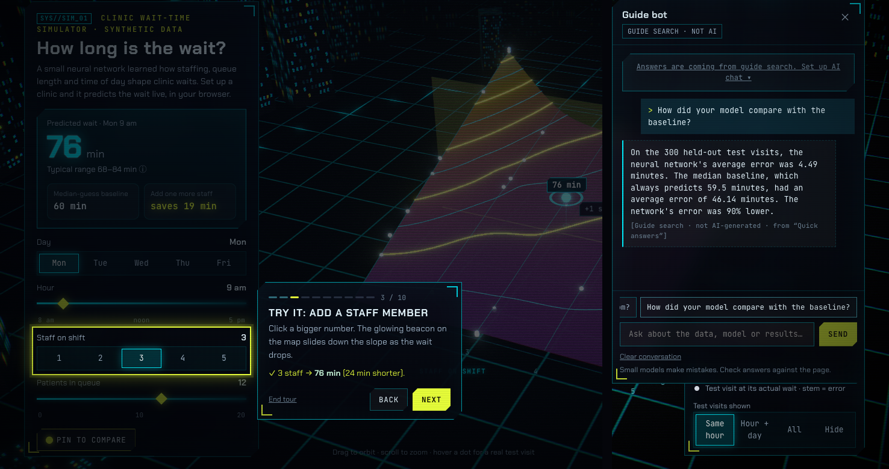

# Queue Cartography: a clinic wait-time simulator

An interactive health-data exhibit for CAI5735 (M14 Health Data Exhibit). A small neural network learned how
**staffing, queue length and time of day** shape clinic wait times. Visitors set up a clinic and the network
predicts the wait live in the browser on a 3-D "wait landscape". A WebGPU chatbot answers questions about what
the model learned, using only a written guide.

- **Live exhibit:** https://cgwilson29.github.io/neural-network/
- **Training notebook:** [`training/train_wait_model.ipynb`](training/train_wait_model.ipynb)
- **Website source:** [`web/`](web/)
- **Chatbot test log:** [`docs/chatbot-test-log.md`](docs/chatbot-test-log.md)



## The question and the data

*How do staffing and queue size affect wait times?* (the "Clinic Wait-Time Simulator" idea from the
[exercise page](https://snsie.github.io/neural-networks/exercise.html)).

Data: [`clinic-wait-times.csv`](https://snsie.github.io/neural-networks/data/clinic-wait-times.csv) from the course
site, a copy of which is in [`data/`](data/). It holds **2,000 synthetic (simulated) visits**: no real patients or
clinics are described anywhere in this project.

| Column | Range | Role |
|---|---|---|
| `hour` | 8–17 | input |
| `day_of_week` | Mon–Fri | input |
| `staff_on_shift` | 1–5 | input |
| `patients_in_queue` | 0–20 | input |
| `wait_minutes` | 0–324 | **target** |

## Model and evaluation

- **Split:** 70 / 15 / 15 (1,400 train / 300 validation / 300 test), stratified by staff, seed 42. The test set
  was used once, at the end. Hyper-parameters and early stopping used validation only.
- **Network:** PyTorch MLP, raw inputs → one-hot hour (10) + one-hot day (5) + standardized staff & queue = 17
  → 16 → 8 → 1 (ReLU), **433 weights**. Preprocessing is built into the model, so the exported ONNX file takes the
  four raw inputs. The network is *not* given the queue ÷ staff ratio; it has to discover that relationship.
- **Baseline (required):** always predict the training median wait (59.5 min).

| Model (test set, 300 visits) | MAE (min) | 95% CI | R² | Within ±10 min |
|---|---|---|---|---|
| Median baseline | 46.14 | 40.3–52.2 | −0.07 | 23% |
| Linear regression (same 17 features) | 26.11 | 23.7–28.7 | 0.76 | 21% |
| Queue ÷ staff formula (reference) | 5.60 | 5.2–6.0 | 0.99 | 87% |
| **Neural network** | **4.49** | **4.1–4.9** | **0.99** | **92%** |

The network's error is **90% lower than the baseline** (bootstrap 95% CI of the difference: −47.7 to −35.8 min).

**What it learned (the exhibit's discovery):** staffing has diminishing returns. With 12 patients waiting on
Monday at 9 am, the 2nd staff member cuts the predicted wait by ~98 minutes, while the 5th saves ~7. It also
picked up the busier hours (9–10 am and 4–5 pm) and a ~5% Monday bump.

**One mistake:** the largest test error was a Wednesday 1 pm visit (3 staff, 9 queued) that took 35.2 min. The
network said 53.3 min, close to the 6 similar training visits (51.8–69.3 min). The visit was simply faster than
all of them: random variation the four inputs can't explain. More informative inputs (visit type, arrivals,
no-shows), range predictions, or more data for sparse settings would help. Details are in notebook §8 and on the
site.

## The exhibit

| Part | What it does |
|---|---|
| **3-D wait landscape** (three.js / React Three Fiber) | Predicted wait for every staff × queue setting at the chosen hour and day, with glowing equal-wait contours. A beacon marks your clinic, a ghost beacon shows "+1 staff", and the 300 test visits float at their actual waits with stems to the prediction. |
| **Simulator controls** | Day, hour, staff and queue. Every change runs the ONNX model in the browser (ONNX Runtime Web, WASM). |
| **Discovery** | Staffing curve, minutes saved per added staff member, pinned A-vs-B comparison, hour × weekday heatmap. |
| **How good is it?** | Model comparison with confidence intervals, predicted-vs-actual scatter (click a visit to load it), residual strips, training curve, the biggest miss. |
| **Network X-ray** | Live neuron activations for your scenario, read from the ONNX model's hidden-layer outputs. |
| **Guide + guide bot** | The guide is filled from `metrics.json`, so its numbers always match the site. The bot answers from the 2–3 most relevant guide passages, says "The guide doesn't cover that." when they don't answer a question, and runs entirely on the visitor's device after they click **Enable chat**. |
| **Cyberpunk skin** | Neon cyan + acid-yellow HUD panels, a neon city skyline and holographic grid around the map, a scan sweep, bloom/chromatic aberration/scanline post-processing, data rain built from the real results, a live ticker, a first-visit boot sequence and occasional glitches. **Calm mode** (◈ FX in the top bar) and `prefers-reduced-motion` turn all motion off. Chart colors were re-validated for contrast and color-blind separation; the map's heat colors are unchanged because they encode data. |
| **Soundtrack** | “Neon Cartography”, an original synthwave loop composed in code (`web/src/fx/synth.ts`) and synthesized live with the Web Audio API: no recordings, no third-party samples, nothing to download. On by default; browsers only allow sound after a click/tap/key, so it starts on the first interaction. ♫ in the top bar toggles it and is remembered; it gets quieter while the guide bot is open and pauses in background tabs. |
| **Onboarding tour** | A first-visit welcome card offers a 60-second, 10-step tour; the "Tour" button restarts it. Several steps are learn-by-doing (add a staff member, lengthen the queue, pin a scenario) and advance when the visitor acts. It is keyboard-accessible, respects reduced motion, and becomes a bottom sheet on phones. |



### The guide bot in every browser

| Tier | Engine | Who gets it | Model (chosen by bake-off) |
|---|---|---|---|
| 1 | **WebLLM** on WebGPU | Chrome/Edge 113+, Safari 26+ (macOS, iOS, iPadOS), Android Chrome, Firefox on Windows (expected) | Qwen3-1.7B (~1 GB; q4f16, or q4f32 without shader-f16) |
| 2 | **CPU mode**: wllama (llama.cpp WebAssembly), **not WebLLM** | Firefox on macOS (WebGPU allows 9 storage buffers per shader; WebLLM needs 10), Firefox on Linux/Android, Chromium without a usable GPU | Qwen3-0.6B GGUF (397 MB, ~12 s per answer on an M5 Max) |
| 3 | **Guide search**, no AI | Everyone, instantly, including while a model downloads; the only option where neither model can run | — |

- **Choosing the tier:** a capability probe (`web/src/chat/probe.ts`) and a pure `chooseTier` function pick the tier.
  The panel explains the choice under "Why this mode?" and always offers the lower tiers.
- **Never fake GPU limits:** every WebLLM model library contains paged-attention shaders that bind 10 storage
  buffers. We counted them in the compiled WGSL. An early workaround that reported 10 to WebLLM made those shaders fail
  silently, and the model produced nonsense (test log, round 0).
- **Sanity check:** a short check after loading now catches that failure mode.
- **Bake-off:** each default is the smallest model whose answers were all supported. Twelve questions (the 3 required,
  3 extra checks and 6 rewordings) were each asked with 3 seeds. No WebLLM model under 1 GB passed (test log,
  round 5).
- **Speed:** retrieval cut prompts from ~1,660 to ~620 tokens and answers from 2–4 s to ~0.8 s. A cached model loads
  in about 3 s.

## Run it locally

```bash
# Train + export (writes web/public/model/wait_mlp.onnx and web/src/data/*.json)
cd training
uv sync
uv run jupyter nbconvert --to notebook --execute --inplace train_wait_model.ipynb
uv run pytest -q

# Website
cd ../web
npm ci
npm run dev            # http://localhost:5173/neural-network/
npm test               # unit + ONNX parity tests (vitest)
npx playwright install firefox && npm run test:e2e   # end-to-end in Firefox

# Chatbot evaluation harness (the site's real engines, retrieval and prompt against the test questions)
npx vite --config tools/chat-eval/vite.config.ts     # then open http://localhost:5198/?engine=webllm&models=qwen3-1.7b
node tools/chat-eval/score.ts ../docs/chatbot-eval/<run>.jsonl   # pre-screen the answers
```

Pushing to `main` runs [`.github/workflows/deploy.yml`](.github/workflows/deploy.yml): tests → build → GitHub Pages.

## Tests

- **pytest** (`training/tests`): split integrity, torch vs NumPy encoding, ONNX vs saved grid, artifact checks.
- **vitest** (`web/tests`): ONNX parity in ONNX Runtime (300 test visits, all 5,250 grid inputs, hidden activations
  to 1e-4), interpolation and contour math, guide/metrics consistency, retrieval recall on 17 questions and the prompt
  budget, prompt assembly and answer clean-up, guide search, model catalog (every ID exists in WebLLM), tier routing
  (`chooseTier`), and the tour's learn-by-doing checks and storage.
- **Playwright** (`web/tests/e2e`, Firefox + Chromium): the model loads in-browser and visitor inputs change
  predictions; findings render; Firefox without a GPU adapter → CPU mode, with guide search answering and **zero**
  model downloads before Enable; Chromium (SwiftShader WebGPU) → WebLLM; a 9-buffer GPU → CPU mode with the reason
  shown; the tour (welcome card → learn-by-doing step → Esc → remembered → restart; bottom sheet at 390 px).

## Limitations

Synthetic data only; inputs limited to the trained ranges; no testing on any other dataset or real clinic;
patterns, not causes; not medical or staffing advice. The small chatbot can still make mistakes, so its answers
were checked against the site (see the test log). WebLLM itself cannot run in Firefox on macOS; that browser gets
the CPU model (not WebLLM) or guide search.

## Credits

Data and assignment: CAI5735 course site. Built with PyTorch, ONNX / ONNX Runtime Web, React, three.js, React
Three Fiber + drei + postprocessing, d3, Floating UI, WebLLM (MLC) and wllama (llama.cpp) running Qwen3. Fonts: Chakra Petch and JetBrains Mono (SIL Open Font License, self-hosted via Fontsource).
